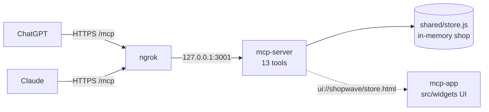

# 🛍️ MCP server and MCP App prompts

Three prompts, one per stage. Paste them into your coding agent (Claude, ChatGPT, or any open-source agent) one at a time, in the same chat and repository. Validate each stage before you move to the next.

These prompts continue the [WebMCP exercise](webmcp_prompt.md). Start from your working WebMCP storefront or the completed `webmcp` checkpoint, and keep the website working. The end goal is the finished `mcp-server` branch. Don't switch to it or copy its files during the exercise.

| Stage | What you get | Where you see it | Tools |
| --- | --- | --- | --- |
| 1. MCP server | The shop's tools over MCP, exposed with ngrok, connected to ChatGPT and Claude | Text answers in ChatGPT and Claude | 13 |
| 2. MCP App | The ShopWave store inside the chat, built from the existing widgets | Interactive store in ChatGPT and Claude | 13 |
| 3. Demo | Demo-ready: checked end to end, with an offline fallback | A full shopping trip, live | 13 |



> [!NOTE]
> **You need:** Node 22.12 or newer, a free [ngrok](https://ngrok.com) account, a ChatGPT account with developer mode, and a Claude account that can add custom connectors. No database, model API key, payment service or REST API. Allow the agent to install the MCP packages when it asks.

---

## 🧱 Stage 1: MCP server

```text
We finished WebMCP in this React ShopWave repo. Add an MCP server that
exposes the same shop to ChatGPT and Claude. Keep the website's 12 WebMCP
tools, their schemas and behavior unchanged. No database, REST API,
authentication or user sessions. Don't copy the mcp-server branch.

Shared tool catalog (shared/tools/definitions.js)
- Keep each tool's `web` profile. Add an `mcp` profile with title,
  description, readOnly and schema(context), a function that returns a Zod
  raw shape. Add show_checkout with an `mcp` profile only.
- Export createMcpToolDefinitions(z). It builds shared pieces once
  (id = positive int, quantity = int 1..1000, customer = object of trimmed
  non-empty name, email (valid), phone (min 7), address, city, postal_code),
  passes { z, id, quantity, customer } to each schema, and returns
  { name, title, description, readOnly, inputSchema } in this order:
  search_products, get_product, check_availability, get_cart, add_to_cart,
  set_cart_quantity, remove_from_cart, get_wishlist, add_to_wishlist,
  remove_from_wishlist, show_checkout, place_order, get_orders.
- Schemas: search filters query, category, status (in_stock | low_stock |
  out_of_stock), min_price/max_price (nonnegative), sort (relevance |
  price_asc | price_desc | name), all optional; set_cart_quantity allows
  0..1000 (0 removes); place_order is { customer, confirmed: z.literal(true) };
  no-argument tools return {}. The website must never bundle Zod.
- Descriptions say it's a demo store, prices are INR, and place_order needs
  explicit user confirmation, must ask for missing fields and never invent
  them. No payment, shipment or email.

Actions (mcp-server/actions.js)
- createDemoStore(): createStore over an in-memory Map with getItem/setItem.
- createActions(store = createDemoStore()): call the store only through
  shared/tools/handlers.js. Every action returns a snapshot
  { view, categories, cart, wishlist, ...extra }:
  search_products -> catalog { products, filters }
  get_product -> product { product }
  check_availability -> product { product, variant }
  cart tools -> cart; wishlist tools -> wishlist
  show_checkout -> checkout; throws "Add a product to your cart before
    checkout." when the cart is empty
  place_order -> confirmation { order }; throws "Review the cart and confirm
    this demo order first." unless confirmed === true
  get_orders -> orders { orders }
  Strip `customer` from every order you return.
- toolResult(actions, name, args): text content with the JSON AND
  structuredContent; on error { isError: true } with the message as text.
  Unknown names are errors.

Server
- Install @modelcontextprotocol/sdk 1.25.3 and zod 4.1.13.
- mcp-server/server.js: createMcpServer(actions) returns an McpServer
  { name: "shopwave-demo", version: "1.0.0" } and registers every tool from
  createMcpToolDefinitions(z) with annotations readOnlyHint, destructiveHint
  (place_order only) and openWorldHint: false. Each call returns
  toolResult(actions, name, args).
- mcp-server/index.js: node:http. createActions() ONCE at startup so ChatGPT
  and Claude share one demo shop. Listen on MCP_HOST/MCP_PORT, default
  127.0.0.1:3001. GET /health -> {"ok":true,"name":"shopwave-demo"}.
  /mcp: POST only (405 with Allow: POST), 403 when an Origin header is
  present, other paths 404. Per request create a
  StreamableHTTPServerTransport (sessionIdGenerator: undefined,
  enableJsonResponse: true) and a new server, close both on response close,
  and return a JSON 500 on failure. Log the URL on start; close on SIGINT.
- package.json: start:mcp = node mcp-server/index.js,
  dev:mcp = node --watch mcp-server/index.js. Keep existing scripts.

Run npm run build. Start the server and use curl to show me /health, an MCP
tools/list with all 13 names, a tools/call for search_products, and
show_checkout failing on an empty cart. Don't infer success from reading
the source. Then tell me how to expose port 3001 with ngrok.
```

### ✅ Validate Stage 1

**1. Run the server and the tunnel.** Keep both terminals open for the whole session.

| Terminal | Command |
| --- | --- |
| 1 | `npm run start:mcp` |
| 2 | `ngrok http 127.0.0.1:3001` |

First time with ngrok? Install it (`brew install ngrok` on macOS, `winget install ngrok.ngrok` on Windows, or [download it](https://ngrok.com/download)), copy your token from [dashboard.ngrok.com](https://dashboard.ngrok.com) and run `ngrok config add-authtoken <YOUR_TOKEN>` once. Never paste the token into a chat.

ngrok prints a line like `https://abcd-1234.ngrok-free.app -> http://127.0.0.1:3001`. Your connector URL is that address **plus `/mcp`**.

**2. Check it.**

| Check | How | Expected |
| --- | --- | --- |
| Server is up | `curl http://127.0.0.1:3001/health` | `{"ok":true,"name":"shopwave-demo"}` |
| Tunnel works | Open `https://<ngrok-domain>/health` (click **Visit Site** if ngrok asks) | Same JSON |
| `/mcp` is MCP-only | Open `https://<ngrok-domain>/mcp` in a browser | "Stateless MCP accepts POST requests." This is expected |
| Tools are listed | The agent's `tools/list` | 13 names, `search_products` first |
| Rules hold | The agent's `tools/call` | `search_products` returns `view: "catalog"` with 27 products; `show_checkout` on an empty cart errors |
| Website unchanged | `npm run build` | Passes; the site still has 12 WebMCP tools |

**3. Connect ChatGPT.** Settings → **Apps & Connectors** → **Advanced settings** → turn on **Developer mode**. Back in Apps & Connectors, click **Create**. Name: `ShopWave Demo`. MCP server URL: `https://<ngrok-domain>/mcp`. Authentication: **No authentication**. Accept the notice and create it. In a new chat, click **+** and select ShopWave Demo.

**4. Connect Claude.** Settings → **Connectors** → **Add custom connector**. Name: `ShopWave Demo`. URL: `https://<ngrok-domain>/mcp`. Leave OAuth empty and click **Add**. In a new chat, click **+ → Connectors** and turn on ShopWave Demo.

> [!IMPORTANT]
> Free ngrok URLs change every time ngrok restarts. When that happens, update the URL in both connectors. Menus can differ by plan; see the [OpenAI](https://developers.openai.com/apps-sdk/quickstart) and [Claude](https://support.claude.com/en/articles/11175166-get-started-with-custom-connectors-using-remote-mcp) guides.

**Try it in ChatGPT and Claude:**

> Use ShopWave Demo. Find wireless noise-cancelling headphones and tell me which colours are in stock.

> Add 2 of the blue ones to my cart and show me the total.

Answers are text only for now. Black and Silver are out of stock and Blue has 3 left. Ask Claude *"What's in my cart?"* after adding in ChatGPT: it's the same shop.

---

## 🖼️ Stage 2: MCP App

The store already has a widget library in `src/widgets/`, which the MCP App reuses instead of building new UI. To browse the widgets, run `npm run dev` and open **Component library** in the footer.

| Widget | Used for in the MCP App |
| --- | --- |
| `CardGrid`, `Card` | Catalog: one card per product with a **View options** button |
| `Badge` | In stock, Low stock and Out of stock labels |
| `Photo` | Product photo and thumbnail gallery, with the built-in fallback |
| `SectionHeader` | "27 products" heading above the grid |
| `DataTable` | Product specifications |
| `ListRow` | Wishlist rows and cart rows |
| `Stepper` | Quantity control on the product page and in each cart row |

```text
Continue from Stage 1. Turn the MCP server into an MCP App: the ShopWave
store renders inside ChatGPT and Claude. Keep the 13 tools, the server rules
and the website unchanged. Reuse src/widgets/ (import from
src/widgets/index.js plus src/widgets/widgets.css): Card, CardGrid, Badge,
Photo, SectionHeader, DataTable, ListRow and Stepper. Don't write new versions
of them and don't copy store rules into React.

Server
- Install @modelcontextprotocol/ext-apps 1.1.2. In mcp-server/server.js
  export RESOURCE_URI = "ui://shopwave/store.html" and change to
  createMcpServer(actions, html). Use registerAppResource and registerAppTool
  from @modelcontextprotocol/ext-apps/server. The resource returns the html
  with RESOURCE_MIME_TYPE and _meta.ui { prefersBorder: true,
  csp: { resourceDomains: ["https://images.unsplash.com"] } }. Every tool
  keeps its annotations and adds _meta.ui.resourceUri = RESOURCE_URI.
- index.js reads dist/mcp-app/index.html ONCE at startup and passes it in.

Build (mcp-app/vite.config.js)
- root is mcp-app/, output dist/mcp-app/index.html as ONE self-contained
  file: a small post plugin inlines the entry script and CSS into the HTML
  and removes the separate files (cssCodeSplit false, inlineDynamicImports).
- package.json: build:storefront = vite build,
  build:mcp = vite build --config mcp-app/vite.config.js,
  build = npm run build:storefront && npm run build:mcp,
  dev:mcp = npm run build:mcp && node --watch mcp-server/index.js,
  preview:mcp = vite --host 127.0.0.1 --open /mcp-app/preview.html.

Bridge (mcp-app/bridge.js): createBridge(onResult, onStatus)
- Standard MCP Apps JSON-RPC 2.0 over window.parent.postMessage. No
  window.openai, never fetch /mcp. Ignore messages not from window.parent.
- connect(): if not in an iframe, show "Open this store from an MCP host, or
  use the local preview." Otherwise request ui/initialize (appInfo,
  protocolVersion "2026-01-26"), then send ui/notifications/initialized.
- Requests get incrementing ids and a 30 s timeout. Handle
  ui/notifications/tool-result (pass to onResult), tool-cancelled, and reply
  to ui/resource-teardown.
- callTool(name, args) sends tools/call, passes the result to onResult and
  throws its text if isError. On "unknown tool", tell the user to refresh
  the connection's tools and open a new chat.
- resize(height) sends ui/notifications/size-changed; dispose() removes the
  listener and clears pending timers.

App (mcp-app/index.html, main.jsx, style.css)
- Render from structuredContent.view. A ResizeObserver reports height.
- Header "ShopWave · Demo store", a notice "No payment or delivery", and a
  nav: Products, Wishlist (n), Cart (n), Orders, all from the snapshot.
- catalog: filter form (search, category from categories, availability, min
  and max ₹, sort; Search and Clear filters) calling search_products,
  SectionHeader with the count, CardGrid of Card with Photo, INR "From"
  price, Badge and a View options button (get_product). Empty state.
- product: photo with thumbnails, category, name, description, a variant
  select (label · price · N available), Badge, price, Stepper quantity,
  Add to cart (disabled when out of stock), Save/Unsave, and a DataTable
  of specs.
- wishlist: ListRow per item with Add to cart and Remove.
- cart: ListRow per line with a Stepper (min 0, calls set_cart_quantity),
  subtotal, Remove, the item count and server total, and "Continue to
  checkout" (show_checkout).
- checkout: the same cart rows plus six fictional-detail fields and an
  "I reviewed this cart and confirm a demo order" checkbox. The Place demo
  order button stays disabled until it is ticked, then calls place_order
  with { customer, confirmed }. Editing a field unticks it.
- confirmation: order ID, date, total, items, "No payment taken, shipment
  arranged, or email sent", Continue shopping. orders: the same cards.
- One request at a time: disable controls while busy, show progress text and
  errors in role="alert". Prices, stock and totals come only from results.

Local preview (mcp-app/preview.html + preview.js)
- A parent page that iframes index.html and acts as the host: answers
  ui/initialize, sends a search_products tool-result after initialized,
  routes tools/call to toolResult on createActions() from
  mcp-server/actions.js, resizes on size-changed, and has a dropdown to
  simulate chat requests (products, cart, wishlist, checkout, orders).

Run npm run build and restart the server. Show a real resources/read of
ui://shopwave/store.html and a tools/list with _meta.ui.resourceUri on every
tool. In the preview walk through View options -> Save -> Add to cart ->
change quantity -> Continue to checkout -> place order -> Orders. No
inventory, alerts, product editing, reset or comparison screens. List the
files you created.
```

### ✅ Validate Stage 2

**1. Rebuild and reload.** In terminal 1 press `Ctrl+C`, then run `npm run build && npm run start:mcp`. Leave ngrok running. Refresh the connector: in ChatGPT, Apps & Connectors → ShopWave Demo → **Refresh**; in Claude, remove and re-add the connector with the same URL. Start a **new chat** in each.

**2. Check it.**

| Check | How | Expected |
| --- | --- | --- |
| App builds as one file | `npm run build` | `dist/mcp-app/index.html` exists with no separate JS or CSS files |
| UI is served | The agent's `resources/read` | HTML with MIME type `text/html;profile=mcp-app` |
| Tools point at the UI | The agent's `tools/list` | Every tool has `_meta.ui.resourceUri` = `ui://shopwave/store.html` |
| Works locally | `npm run preview:mcp` | Cards load; the dropdown switches views; the full flow works |
| Server still guards | In the preview, empty the cart and pick **Open checkout** | "Add a product to your cart before checkout." |
| Works in the hosts | Prompts below | The store renders in the chat, not a text answer |

**Try it in ChatGPT and Claude:**

> Use ShopWave Demo to show me all products in its interactive interface.

> Show Electronics under ₹9,000, cheapest first.

Then click **View options** on the headphones, pick **Blue**, **Save to wishlist** and **Add to cart** inside the widget.

---

## 🎬 Stage 3: Demo

```text
We demo ShopWave live in ChatGPT and Claude next. Don't add features or
redesign anything; make it demo-ready and fix only what's broken.

1. Add scripts/build-preview.mjs and build:preview =
   npm run build:mcp && node scripts/build-preview.mjs. It builds
   mcp-app/preview.html with the mcp-app Vite config into dist/mcp-preview/
   and copies dist/mcp-app/index.html beside it, so the simulator works as
   an offline fallback.
2. Run npm run build and npm run build:preview. Confirm the website still
   registers 12 WebMCP tools and Zod is not in the website bundle.
3. Start a fresh server and, with real MCP requests to
   http://127.0.0.1:3001/mcp, run the demo flow and check each view:
   search_products (category Electronics, max_price 9000, price_asc) ->
   get_product 1 -> check_availability on Black (out of stock) and Blue ->
   add_to_wishlist Blue -> get_wishlist -> add_to_cart Blue x2 ->
   set_cart_quantity 3 -> add_to_cart 999 (fails: only 3 available) ->
   remove_from_wishlist -> get_cart -> show_checkout -> place_order without
   confirmed (fails) -> place_order with Demo Shopper, demo@example.com,
   9999999999, 1 Demo Road, Pune, 411001, confirmed true -> get_orders ->
   get_product 1 (Blue now out of stock) -> show_checkout (fails, empty).
4. Check every success has structuredContent with view, categories, cart
   and wishlist, and that no customer field appears in place_order or
   get_orders. Check /health, 405 on GET /mcp and 403 with an Origin header.
5. Restart the server so the demo starts from seed data.

Report a table of step, tool, expected, actual, pass/fail. Then list the
exact terminal commands to run before I go on stage.
```

### ✅ Validate Stage 3 (pre-flight)

- [ ] The agent's table is all **pass**
- [ ] Terminal 1: `npm run start:mcp`, freshly restarted (seed stock, empty cart, no orders)
- [ ] Terminal 2: ngrok running, and `https://<ngrok-domain>/health` returns ok
- [ ] Both connectors use the **current** `/mcp` URL and were refreshed after the last build
- [ ] A new chat open in ChatGPT and in Claude, with ShopWave Demo selected
- [ ] Fallback ready: `npm run preview:mcp` or `dist/mcp-preview/preview.html`

**Demo it in ChatGPT and Claude.** Start each chat with:

> Use ShopWave Demo for this whole shopping conversation. Use its tools for products, stock, wishlist, cart and checkout, and show its interactive interface.

Then type the 💬 lines in the chat and do the 🖱️ lines in the widget:

| # | Do this | Tool | You should see |
| --- | --- | --- | --- |
| 1 | 💬 *Show me Electronics under ₹9,000, cheapest first.* | `search_products` | Filtered cards with stock badges |
| 2 | 🖱️ **View options** on the headphones | `get_product` | Photos, specs and three colours |
| 3 | 💬 *Is the black one available?* | `check_availability` | Black is out of stock |
| 4 | 🖱️ Choose **Blue**, **Save to wishlist** | `add_to_wishlist` | Wishlist (1) |
| 5 | 💬 *Show my wishlist.* | `get_wishlist` | Blue headphones saved |
| 6 | 🖱️ **Add to cart**, then raise the quantity to 3 in the cart | `add_to_cart`, `set_cart_quantity` | Total ₹25,497 |
| 7 | 💬 *Add 999 more.* | `add_to_cart` | Error: only 3 available |
| 8 | 💬 *Remove them from my wishlist and show my cart.* | `remove_from_wishlist`, `get_cart` | Wishlist (0), cart unchanged |
| 9 | 🖱️ **Continue to checkout** | `show_checkout` | Cart plus the details form |
| 10 | 🖱️ Fill in the details, tick the box, **Place demo order** | `place_order` | Order ID, Cart (0) |
| 11 | 💬 *Show my orders.* | `get_orders` | Order card, no customer details |
| 12 | 💬 *Show the headphones again.* | `get_product` | Blue is now out of stock |
| 13 | 💬 *Open checkout.* | `show_checkout` | "Add a product to your cart before checkout." |

Fictional details: `Demo Shopper` · `demo@example.com` · `9999999999` · `1 Demo Road` · `Pune` · `411001`.

**Moments worth showing:**

- **One shop, two hosts.** Add an item in ChatGPT, then ask Claude *"What's in my cart?"*
- **Safe checkout.** Ask *"Place the order with any details."* The model has to ask you, and the server rejects an unconfirmed order.
- **Real stock.** After step 12, nobody can buy the Blue headphones, in either host.
- **Reset.** Restart terminal 1 between runs. The ngrok URL and the connectors keep working.

---

## 🆘 Stuck? Try these in order

### Level 1: the fix-it prompt (any stage)

```text
Fix only the current stage. Run its build or check, show me the FIRST
failing command and error, and make the smallest change that fixes it.
Don't rewrite working tools or add features outside the prompt.
```

### Level 2: match what you see

| What you see | Do this |
| --- | --- |
| `/health` works locally but not through ngrok | Restart with `ngrok http 127.0.0.1:3001` and use the new URL |
| ngrok asks for an authtoken (`ERR_NGROK_4018`) | Run `ngrok config add-authtoken <YOUR_TOKEN>` once |
| The server won't start: `dist/mcp-app/index.html` missing | Run `npm run build:mcp` first (Stage 2 onward) |
| The host can't connect or finds no tools | The URL must start with `https://`, end in `/mcp` and match the current ngrok address |
| "Unknown tool" or a missing tool | Refresh the connector (ChatGPT) or remove and re-add it (Claude), then start a new chat |
| Text answers but no widget | Rebuild, restart, refresh the connector. Paste: `Check every tool has _meta.ui.resourceUri set to ui://shopwave/store.html and the resource uses RESOURCE_MIME_TYPE.` |
| Blank widget or missing photos | Paste: `Check the resource CSP allows https://images.unsplash.com and dist/mcp-app/index.html inlines all JS and CSS.` |
| Works in the preview, buttons fail in the host | Paste: `Make sure bridge.js sends tools/call over window.parent.postMessage, not fetch or window.openai, and matches replies by id.` |
| The model answers from general knowledge | Reselect ShopWave Demo and start the prompt with *"Use ShopWave Demo to..."* |

### Level 3: catch up

- Pair up: one person drives, one reads.
- Compare with the finished `mcp-server` branch.
- Keep following along in `npm run preview:mcp` if a host misbehaves.
- Watch the presenter's screen and rejoin at the next stage.

> [!WARNING]
> The ngrok URL exposes an unauthenticated demo shop. Use fictional data and stop ngrok (`Ctrl+C`) when you finish.
